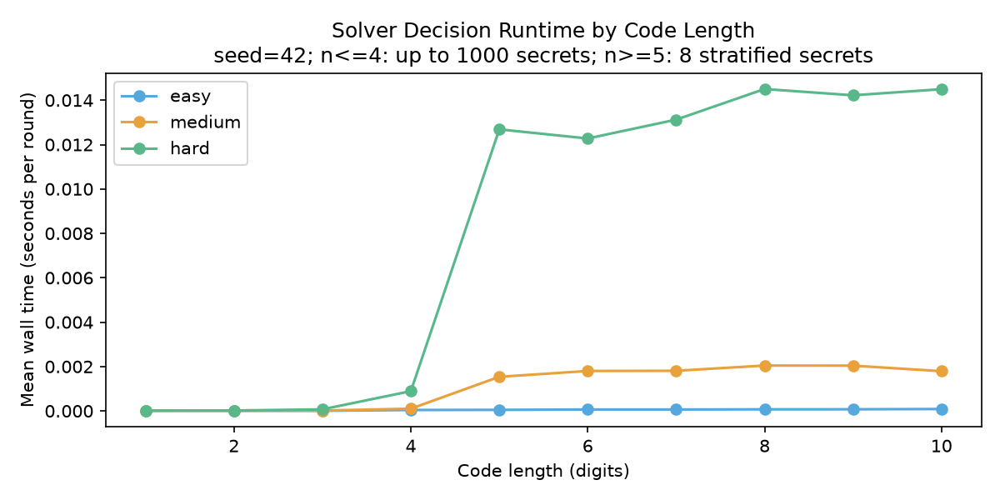
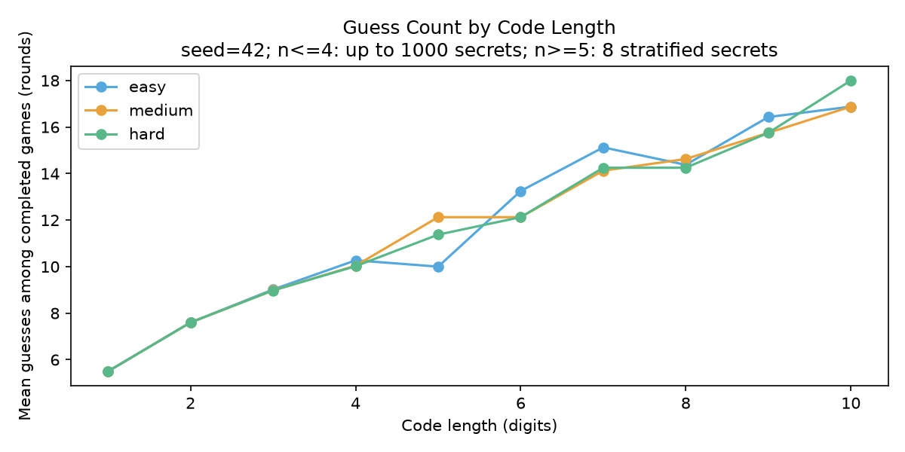
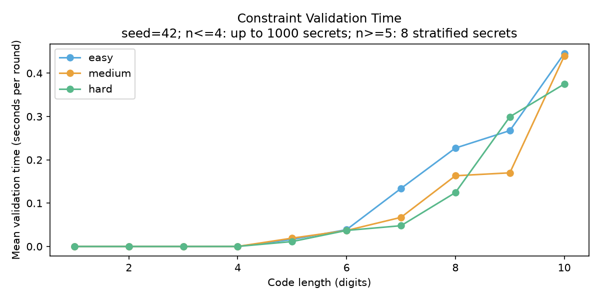
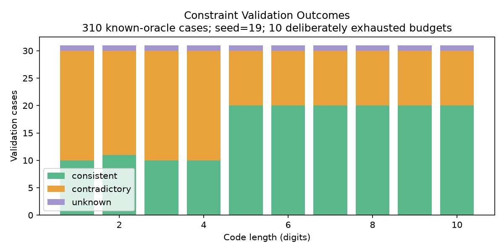
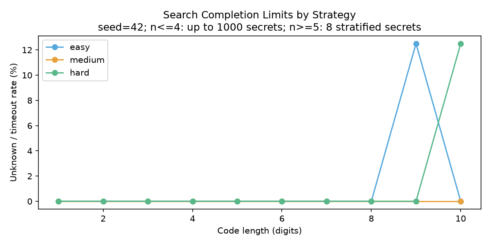

# CodeDuel Solver Lab — Constraint-Based Search and Feedback Validation

CodeDuel Solver Lab explores constraint-based reasoning and feedback validation
for variable-length code-breaking problems. It makes a deliberately sharp
separation between finding a feasible explanation, proving a contradiction and
running out of computation.

The human **never enters their secret**. The solver sees guesses and reported
position counts only. It is a human-in-the-loop search application, **not a
trained ML model or an LLM agent**.

## Problem and constraint formulation

For a code of length n, each `x_i` is in `{0,...,9}`. A guess `g` with feedback r
adds the equality:

`sum(x_i == g_i for i in range(n)) == r`

All historical equalities must hold at once. Codes are strings; repeated digits
and leading zeros are preserved. A report can be wrong while still admitting
some secret, so the program **cannot detect every human reporting error**.

## Supported lengths and search

| Length | Representation | Candidate count |
|---|---|---|
| 1–4 | Exact enumeration and full-history pruning | Exact |
| 5–10 | Finite-domain propagation + randomized backtracking witnesses | Found samples only; total not counted |

The full search space grows from 10^4 to 10^10. Ten-digit enumeration would be
inappropriate; the solver never materializes that universe. Constraint propagation
tracks forced and possible matches per clue. Equal lower/upper match bounds
force or eliminate digits; backtracking branches on a smallest remaining domain.
Sampling uses repeated randomized witness searches, **not a uniform sampler**.

Easy selects a random valid candidate/sample; Medium uses sampled expected-size
heuristics; Hard uses entropy and a near-tie Minimax criterion. Short-code Hard
can evaluate exact distributions; long-code distributions only describe the
feasible sample pool. None of these are globally optimal algorithms.

## Three-state feedback validation

| Status | Required evidence | State update |
|---|---|---|
| Consistent | At least one satisfying witness | Commit feedback |
| Contradictory | Exhaustive infeasibility proof | Reject, retain pending round |
| Unknown | No witness or proof before the resource limit | Reject, retain pending round |

`constraints.py::ValidationResult` includes status, witnesses, visited nodes,
measured seconds and termination reason. A resource limit reached **after** finding
a witness is still Consistent; it only truncates sampling. UNKNOWN is never an
empty-candidate contradiction. The defaults are 180 witness attempts, 150,000
search nodes and a 1-second wall budget. Exhaustive UNSAT search is only reported
when completed; timeout is not a proof. No third-party solver is required.

## Manual-feedback gameplay

1. Choose English or 简体中文, code length (1–10) and difficulty.
2. Keep one fixed secret on paper or in mind; do not enter it into this program.
3. Submit your guess about the AI's fixed secret. Both guesses are locked.
4. Read the AI guess; select how many positions match your human-owned secret.
5. Confirm. Consistent feedback commits both scores; contradictions/UNKNOWN keep
   the pending round so you can correct the current feedback.
6. A success on both sides in the same round is a draw.

The AI receives no human secret through its constructor, references or decision
parameters. Already committed feedback is immutable; correcting an earlier
mistake currently requires restarting. A logically consistent lie cannot be
identified without knowing the real secret.

## Reproduced benchmarks

| Digits | Secrets / strategy | Easy mean | Medium mean | Hard mean | Unknown / games |
|---|---:|---:|---:|---:|---:|
| 1 | 10 | 5.500 | 5.500 | 5.500 | 0 / 30 |
| 2 | 100 | 7.600 | 7.600 | 7.600 | 0 / 300 |
| 3 | 1000 | 9.017 | 8.979 | 8.978 | 0 / 3000 |
| 4 | 1000 | 10.271 | 10.040 | 10.019 | 0 / 3000 |
| 5 | 8 | 10.000 | 12.125 | 11.375 | 0 / 24 |
| 6 | 8 | 13.250 | 12.125 | 12.125 | 0 / 24 |
| 7 | 8 | 15.125 | 14.125 | 14.250 | 0 / 24 |
| 8 | 8 | 14.375 | 14.625 | 14.250 | 0 / 24 |
| 9 | 8 | 16.429 | 15.750 | 15.750 | 1 / 24 |
| 10 | 8 | 16.875 | 16.875 | 18.000 | 1 / 24 |

Seed 42. n=1,2,3 cover their full spaces; n=4 uses 1000 distinct sampled secrets.
For each long length and strategy, 8 stratified secrets include all-zero,
all-identical, leading-zero and random cases. **Long-code means exclude UNKNOWN
games, which remain visible in the last column**: 142 of 144 completed, 2 UNKNOWN,
0 failed and 0 detected illegal guesses. This small long-code sample is a smoke /
stress experiment, not a reliable population-efficiency estimate.







The dedicated validation experiment has **310 known-oracle cases**, seed 19:
all 310 outcomes matched expectations, 0 false contradictions, 10 deliberately
exhausted-budget UNKNOWN cases. Small lengths use enumeration oracles; large
lengths use known satisfying witnesses and analytically proven contradictions.
Peak traced Python allocations were 714,991 bytes, including the oracle and
stored rows, not total OS RSS. Timings with tracemalloc include its overhead.
These measurements do not constitute a proof for all possible histories.

Environment: macOS-26.5.2-arm64-arm-64bit-Mach-O, Python 3.14.6. All metadata,
parameters, actual UTC timestamps, aggregated traces and raw per-game compressed CSV data live
under `benchmarks/results/`. Cache-aware decision timing is not a cold-start
latency guarantee. Wall-clock limits are load-dependent and can change the
number of UNKNOWN outcomes on another machine.

## Architecture

- `rules.py`: one positional score function, validation and small universes.
- `constraints.py`: explicit tri-state bounded feasibility search.
- `solver.py`: atomic history update; failed validation never changes candidates.
- `strategies.py`: legal-guess selection and measured diagnostic metrics.
- `engine.py`: lock guesses, then validate feedback and settle both sides.
- `gui.py`: bilingual Tk UI and worker/main-thread queue boundary.
- `simulation.py`, `scripts/`: reproducible evaluation and real-data plots.

## Demo, installation and reproduction

The real Tk integration flow passed in both languages. Screenshot capture via
the native tooling failed; no invented UI image is used. To open real scenes:
`python -m scripts.demo --stage game --language en` or
`python -m scripts.demo --stage result --language zh`.

```sh
python -m venv .venv
# macOS/Linux:
source .venv/bin/activate
# Windows PowerShell: .venv\Scripts\Activate.ps1
python -m pip install -e ".[dev]"
python main.py
```

Python 3.11+ and Tk are required. The game itself uses only the standard library;
`dev` installs pytest, Ruff, and Matplotlib for tests and experiments. Check Tk
with `python -m tkinter`. On Debian/Ubuntu install `python3-tk`; on Windows keep
Tcl/Tk enabled in the Python installer. The interface offers **English** and
**简体中文** on the setup screen, including prompts, errors and results.

```sh
python -m pytest -q
ruff check .
ruff format --check .
# Requires a desktop, or xvfb-run -a on Linux:
python -m tests.gui_smoke
```

Both projects install a package named `code_duel`: use a separate virtual
environment for each. Do not install both in the same environment.

```sh
python -m code_duel.simulation --secret 0000000037 --difficulty hard --seeds 42
python -m code_duel.simulation --count 1000 --lengths 1 2 3 4 --seeds 42 --output benchmarks/results/small
python -m code_duel.simulation --count 8 --lengths 5 6 7 8 9 10 --seeds 42 --output benchmarks/results/large
python -m scripts.validate_constraints
python -m scripts.plot_results
```

Current local result: **26 tests passed**, plus 7 subtests; no failures or skips.
Tests include exact-oracle cross-checks, known SAT/UNSAT, explicit UNKNOWN,
truthful long histories, failed-feedback atomicity and correction, all lengths,
leading zeros, repeated digits, legal strategy outputs and same-round draws.
Real Tk integration covers 2/10-digit games, contradiction warning and correction.
See [test output](docs/test-results.txt). Full batch experiments are manual CI jobs;
regular CI tests core invariants and a Linux Xvfb GUI flow. Consult the actual
[Actions page](https://github.com/lguo0029/code-duel-solver-lab/actions) for remote
status rather than assuming local success is a CI pass.

## Known limits and next steps

Long-code sample counts are not model counts, samples can be biased, hard
histories may time out, and the one-second bound is checked between search
nodes (a propagation step may overrun it). An incremental solver with explicit
unsat cores, improved uniform sampling, editable historical feedback and more
seeds are future work. Short-code constraints are also cross-tested with the
same backtracking routine; this is evidence, not a formal verification proof.
No performance claim is made about the whole ten-digit space.

## Related project and portfolio materials

[CodeDuel Game](https://github.com/lguo0029/code-duel-game) is the reconstructed
original-style four-digit automatic-feedback game. Solver Lab preserves and
refactors the available later source. They explicitly share scoring/strategy/UI
lineage but have independent engines, environments, tests and releases.

[Interview notes](docs/interview_notes.md) · [Resume bullets](docs/resume_bullets.md) ·
[Project pitch](docs/project_pitch.md) · [Provenance](docs/provenance.md) ·
[中文说明](README.zh-CN.md)

## License

MIT; see [LICENSE](LICENSE). No external solver, LLM service or API key is used.
